
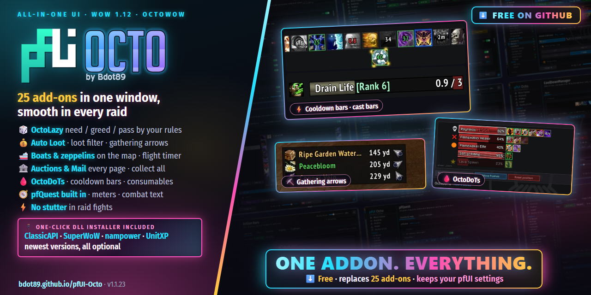

<h1 align="center">🐙 pfUI Octo for OctoWoW</h1>

<b>One addon. Everything.</b> Your whole interface, 26 add-ons' worth, in one window that runs smooth in every raid. ✨

<a href="https://github.com/bdot89/pfUI-Octo/releases/latest/download/pfUI.zip"><b>⬇️ Download pfUI Octo (ZIP)</b></a> &nbsp;·&nbsp;
<a href="https://bdot89.github.io/pfUI-Octo/"><b>🏠 Home page with pictures</b></a> &nbsp;·&nbsp;
<a href="https://github.com/bdot89/pfUI-Octo/releases"><b>📜 What's new</b></a> &nbsp;·&nbsp;
💬 Discord: <b>benito9295</b>

> [!CAUTION]
> ## 📁 The folder must be called `pfUI` - nothing else!
> ✅ `Interface\AddOns\pfUI` &nbsp;&nbsp; ❌ `Interface\AddOns\pfUI-Octo-octo` / `pfUI-master`
> GitHub's green **Code → Download ZIP** names it `pfUI-Octo-octo`: rename it to **`pfUI`**, or the game won't load it (OctoLauncher says "Missing .toc file"). The ZIP from **Releases** is already right.

## 🔗 Which link is which

| | Link | What it's for |
|---|---|---|
| ⬇️ **Download (ZIP)** | [pfUI.zip](https://github.com/bdot89/pfUI-Octo/releases/latest/download/pfUI.zip) | The newest version. Unzip, put the **pfUI** folder in `Interface\AddOns`. |
| 🚀 **OctoLauncher link** | `https://github.com/bdot89/pfUI` | Paste it in OctoLauncher: **Addons → Add custom git addon**. It installs **and updates** pfUI Octo for you. |
| 🏠 **Home page** | [bdot89.github.io/pfUI-Octo](https://bdot89.github.io/pfUI-Octo/) | Every feature with pictures. Also on the **About** page in game. |
| 📜 **What's new** | [Releases](https://github.com/bdot89/pfUI-Octo/releases) | Every version and what changed. |
| 🐙 **This page** | [github.com/bdot89/pfUI-Octo](https://github.com/bdot89/pfUI-Octo) | Source code and this guide. |
| 🧩 **Original pfUI** | [github.com/shagu/pfUI](https://github.com/shagu/pfUI) | Shagu's pfUI, which pfUI Octo is built on. Your pfUI settings keep working. |

## 🗑️ Drop these add-ons: pfUI Octo does it all

Fewer add-ons = fewer clashes and more frames. Everything below is **built in**, in one options window (`/pfui`), and each part has an **on/off switch** - switched off, it isn't even loaded. The **About** page in game lists the ones you still have on, with a "turn off" link beside each.

| pfUI Octo part | Replaces | |
|---|---|---|
| 🎲 **OctoLazy** | _LazyPig | Need / Greed / Pass **by your own rules**, invites, summons, battlegrounds, NPC chat skipped |
| 💰 **Auto Loot + Loot filter** | AutoAreaLoot | Loots every corpse around you, takes what you want, leaves the junk |
| ⛏️ **Gathering** | gathering finders | The nearest herbs, ore, fish and chests with **arrows and distances** |
| 🚢 **Boats & zeppelins** | transport timers | Every boat, zeppelin and the tram **on the world map**, with arrival times |
| 🦅 **Flight timer** | flight timer add-ons | How long every flight takes, learned and shared |
| 🏦 **Auctions** | aux, Auctionator | Search every page at once, sell at the going price, price history, deals, ledger |
| 📬 **Mail** | TurtleMail, Postal | Whole inbox in one list, **Collect all** that never stalls, send many items at once |
| 🩸 **OctoDoTs** | Cursive | Every enemy with its DoTs and real timers, multi-DoT macros |
| 💧 **OctoRinse** | UpsiRinse / Rinse / Decursive | One-key decursing, per-boss lists, quick class / group / player rules |
| ⏳ **CoolDownManager** | cooldown bars | Your cooldowns fill the bars by themselves, glows when ready |
| 🧪 **OctoConsumes** | consume trackers | Flasks, elixirs, food: what's missing, one key to put it on |
| 🧭 **pfQuest built in** | pfQuest, Questie | Quest givers and objectives on the map, tracker, `/db` search |
| 📊 **Meters + Threat** | Details!, DPSMate, ShaguDPS, KTM, TWThreat | Up to 6 windows, every spell, target and death |
| 💥 **Combat Text** | SCT, MSBT | Five areas you place yourself, crits, sounds, alerts |
| 🎯 **Nameplates** | ShaguPlates | Plater-style plates: auras, casts, threat colours, quest marks |
| 🛡️ **ItemRack** | ItemRack, Outfitter | Instant gear swaps, trinket queue, talent specs |
| ⏱️ **Swing Timer** | SP_SwingTimer | Main hand, off hand, ranged, parry haste |
| 🎒 **Bags** | Bagnon, OneBag, Bagshui | One window, categories, one-click sorting |
| 📈 **Character stats** | BetterCharacterStats | Every stat on the character window |
| 🎨 **Custom media** | pfUI-CustomMedia | 400+ bar textures, 70+ fonts, gryphons, button backgrounds |

## 🌟 Everything inside

**🧭 Layout mode (`/moveui`):** every frame gets a labelled box. Drag and snap, resize with the wheel, lock frames together, **right-click a box for its options**.

| | |
|---|---|
|  🎲 **OctoLazy**: one rule per item and dungeon - Zul'Gurub bijous, Black Morass sand, Necrotic Runes. Click a roll to change it | 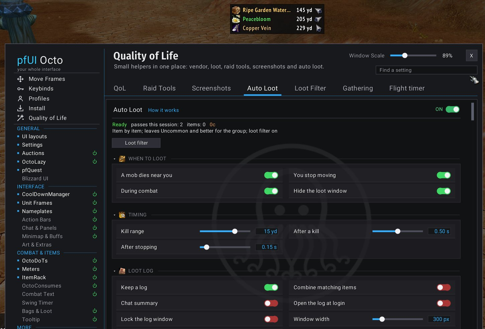 💰 **Auto Loot**: every corpse around you, the moment the fight ends |
| 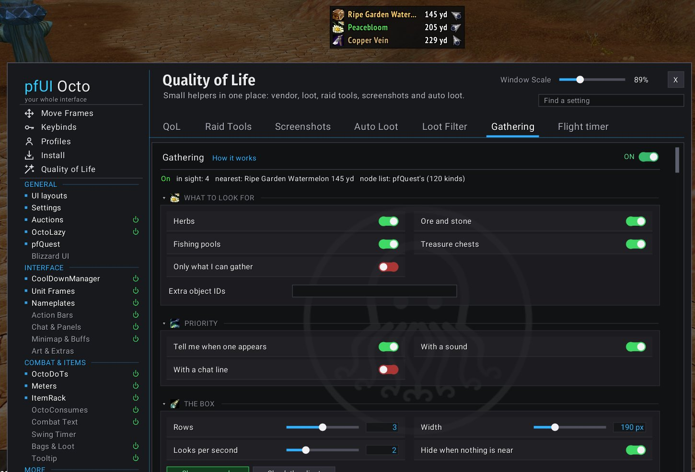 ⛏️ **Gathering**: the nearest nodes with arrows, shared with your group |  🦅 **Flight timer**: a bar with every stop, how long is left |
|  🏦 **Auctions**: our own auction window, every page at once | 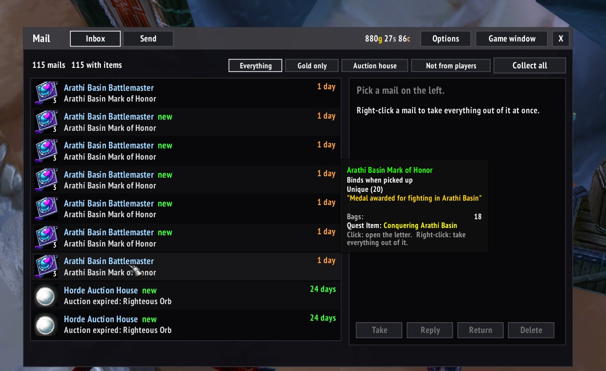 📬 **Mail**: the whole inbox in one list, Collect all |
| 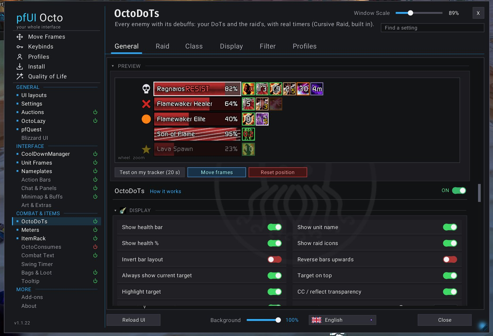 🩸 **OctoDoTs**: every enemy and its debuffs, real timers |  ⏳ **CoolDownManager**: bars that fill themselves |
| 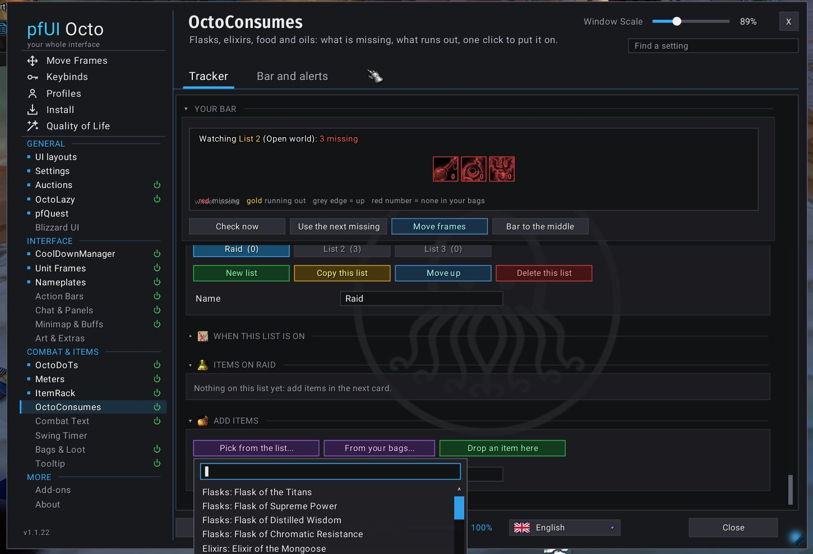 🧪 **OctoConsumes**: never pull without your flask | 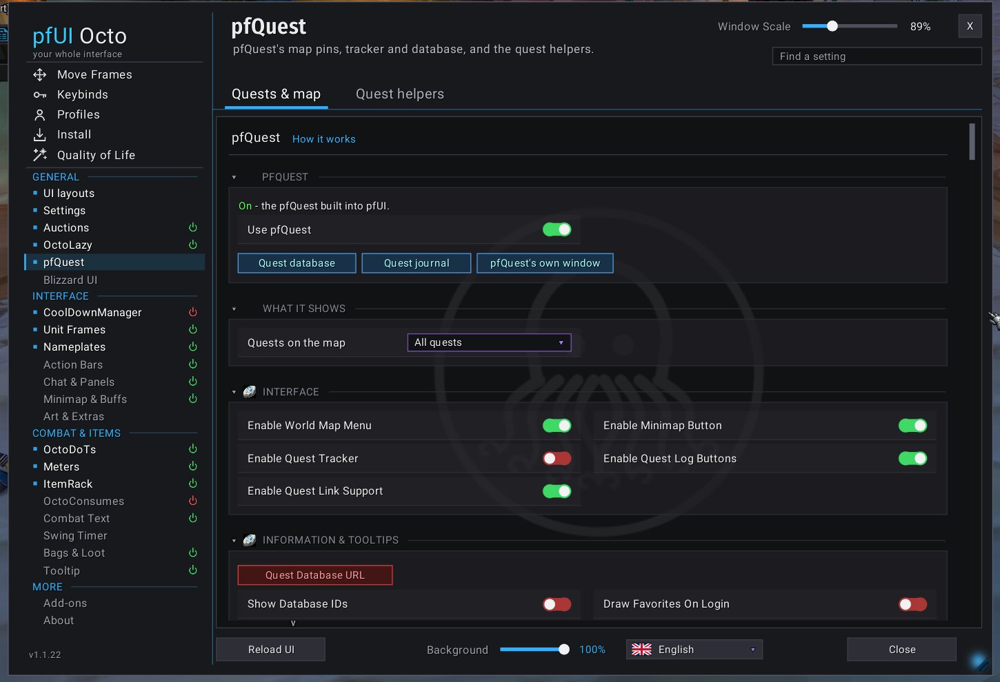 🧭 **pfQuest built in**: map pins, tracker, database |
|  🧍 **Unit frames**: player to raid, live preview |  🖱️ **Click casting** on every frame |
|  🎯 **Nameplates**: sample plates you click to change |  ⚔️ **Action bars**: button looks, proc glows, fading |
|  📊 **Meters & threat**: Details!-deep breakdowns | 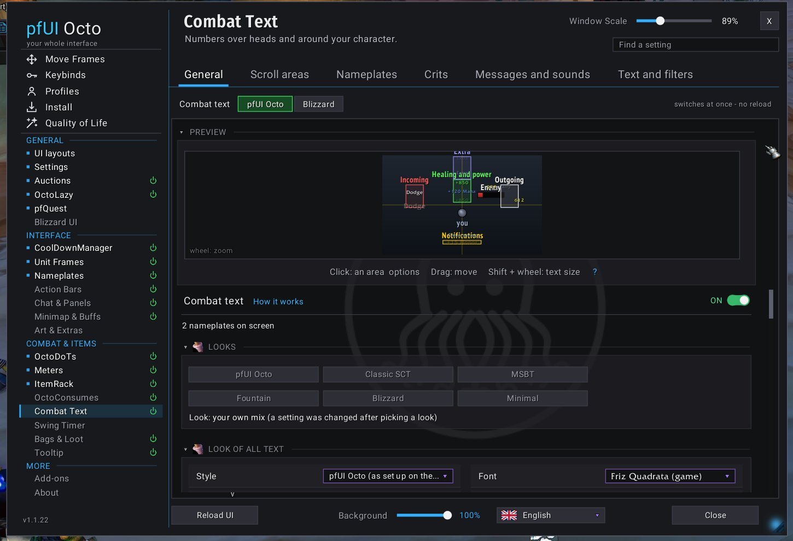 💥 **Combat text**: place every area yourself |
|  🛡️ **ItemRack**: gear sets, trinkets, specs | 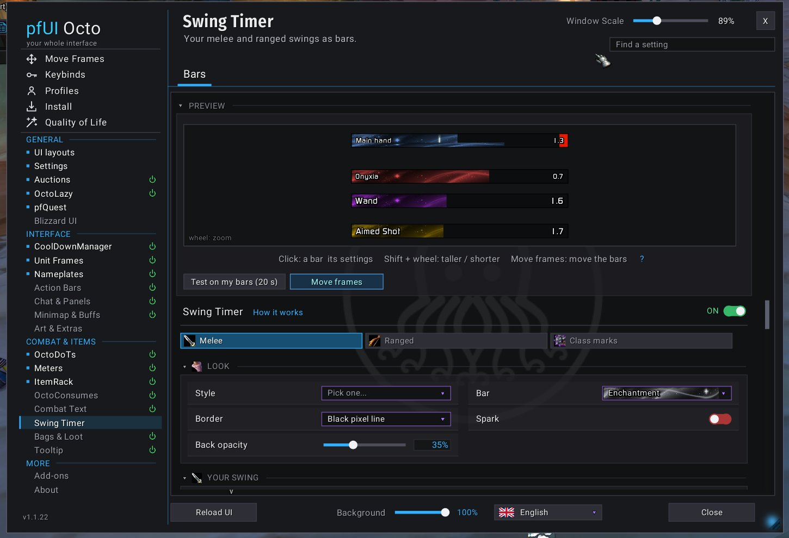 ⏱️ **Swing timer**: every hand, every haste |
| 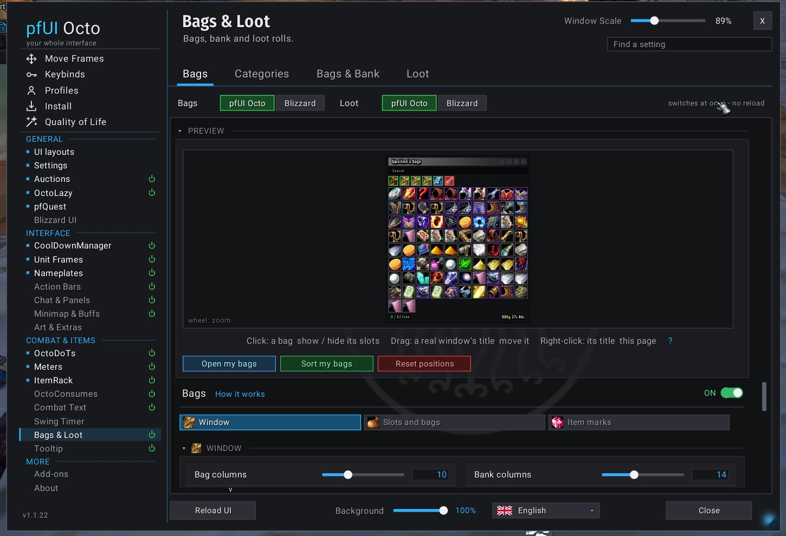 🎒 **Bags**: categories inside one window |  🗺️ **Minimap & buffs**: shapes, buttons, timers |
| 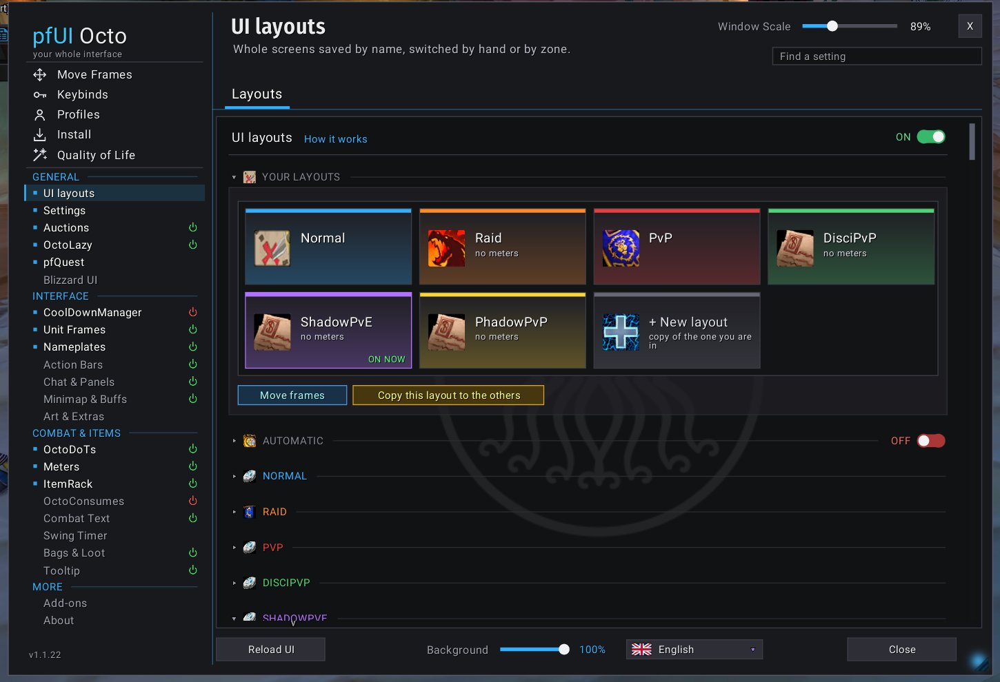 🗺️ **UI layouts**: Normal, Raid, PvP - switch by zone |  🔁 **Octo or Blizzard**: a switch for every part |
|  🛠️ **Quality of Life**: raid tools, vendor, screenshots | 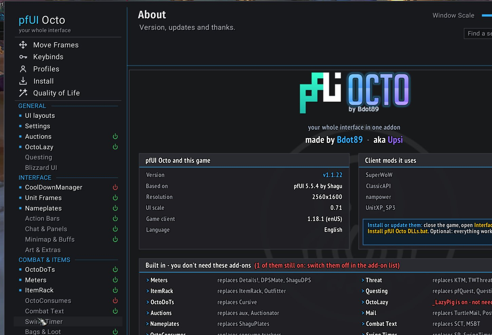 📋 **About**: your client mods and the add-ons you can drop |

And more: 🚢 boats, zeppelins and the tram on the world map with arrival times, 🎨 106 elite crests and 7 raid mark sets, ⌨️ a Key Map of your keyboard, 💬 whisper windows, 🌍 the map revealed, 🔔 sale alerts and a gold ledger.

## ⚡ Smooth in every raid

- 🧹 **No hitch mid-pull:** the game's memory clean-up is held until the fight is over (**Settings → Performance**).
- 🎆 **Raid graphics:** inside raids the costliest effects (full-screen glow, weather, particles) go down, and your own settings come back when you leave.
- 📉 **Measure it yourself:** `/pfperf` shows the CPU time of every add-on and the busiest frames (with ClassicAPI).
- 🔇 Everything you switch off isn't loaded at all.

## 🛠️ Install in 4 steps

1. **Close the game.** Add-ons and DLLs are only read when the game starts.
2. **Get pfUI Octo**, one of two ways:
   - 🚀 **OctoLauncher (easiest, updates itself):** **Addons → Add custom git addon** → paste `https://github.com/bdot89/pfUI` → **Check for updates** keeps it current.
     > ❗ Remove an old pfUI first (OctoLauncher's Addons list, or delete `Interface\AddOns\pfUI`; your settings live in `WTF` and stay). OctoLauncher's own list has a *different* pfUI under the same name: don't press **Update** on a ZIP install.
   - ⬇️ **ZIP:** [download pfUI.zip](https://github.com/bdot89/pfUI-Octo/releases/latest/download/pfUI.zip), **Extract All**, put the **pfUI** folder in `OctoWoW\Interface\AddOns` (replace the old one: your settings stay).
3. **Run the DLL installer** *(optional)*: in the pfUI folder double-click **`Install pfUI Octo DLLs.bat`**. "Windows protected your PC": **More info → Run anyway**. It fetches the newest ClassicAPI, SuperWoW, nampower and UnitXP_SP3 from their authors, backs up the old ones and updates `dlls.txt`.
4. **Play!** 🎮 Start the game from **OctoLauncher**. A short wizard picks your look; `/pfui` opens the options, `/moveui` moves frames.

## 🔌 The DLLs: what they add

All optional: pfUI Octo works without them.

| DLL | What it adds |
|---|---|
| 🧬 **ClassicAPI** | Instant gear swaps and sorting, real focus, "can't interrupt" cast bars, DoT timers, Auto Loot, the profiler, item counts |
| 🦸 **SuperWoW** | Focus by GUID, `/pfcast` mouseover casting, enemy cast bars, real casts for meters and the swing timer |
| 🚀 **nampower** | Your queued spell on the cast bar, casts for combat text and meters |
| 📏 **UnitXP_SP3** | Exact distances and line of sight for range fading |
| 🏦 **AuctionQueryThrottle** *(optional extra)* | Auction searches without the game's 5-second wait |

## ⌨️ Commands

| | |
|---|---|
| `/pfui` | the options window |
| `/moveui` | layout mode: move, size, snap, hide |
| `/lazy` | OctoLazy (roll rules, invites, battlegrounds) |
| `/dot` | OctoDoTs (`/dot cast <spell>` for multi-DoT macros) |
| `/autoloot`, `/gather`, `/flight`, `/transports` | Auto Loot, gathering, flight timer, boats & zeppelins |
| `/cdm`, `/consumes`, `/gear` | cooldown bars, consumables, gear sets |
| `/layout [name]` | next UI layout, or the one you name |
| `/keymap`, `/sct` | the Key Map, combat text |
| `/pfperf` | performance numbers (`on`, `off`, `reset`, `clean`) |
| `/export`, `/import` | share your whole setup |

## 📜 New in 1.1.68

- 🪨 **Earthen Bulwark bar for tank shamans:** with Elemental Weapons and Rockbiter, a small movable bar shows how full your earthen bulwark is (the server's own integrity %) and about how much it holds (up to 20% of your max health). It turns bright with an 8 s timer line while it is absorbing, and says x3 while you wear a shield. Unit Frames > Earthen Bulwark or `/bulwark`. New file: restart the game fully once.

## 📜 New in 1.1.67

- 🩸 **OctoDoTs: pick what shows:** at the top of the Target bar page, Show = Both, Bars only (no target bar) or Target bar only (the Cursive-style bars stay away and cost nothing; they still show in layout mode so you can move them).

## 📜 New in 1.1.66

- 📊 **Meters use ClassicAPI's new damage meter:** with ClassicAPI 1.22 or newer, the current fight and Overall take damage, DPS, healing, HPS, interrupts, dispels, damage taken, deaths and enemy damage taken straight from the DLL - less work for the game in big raids. Earlier fights, the breakdown, uptime, threat and every other display stay ours. ClassicAPI's own meter window stays hidden unless you want it (Meters > Data). New file: restart the game fully once.
- 🔎 **`/pfmetercheck`** (or the button on Meters > Data) prints our totals next to ClassicAPI's for the current fight (`/pfmetercheck overall` for all fights).
- 🩸 **Target bar, per spell:** right-click a spell's icon (in the preview or the spell grid) for its own glow, when it glows (running out, always, missing), glow colour, time text, number size and place, and animations when it runs out or is put on.
- 📐 **Target bar box:** it now has its box in layout mode even while switched off, a tidy fixed width (Look > Room for icons), and its tab sits right after General in OctoDoTs.

## 📜 New in 1.1.65

- 🩸 **OctoDoTs Target bar:** a movable row of your own DoTs and bleeds on your target (Rake, Rip, Moonfire, Insect Swarm, Faerie Fire...), each as its spell icon with the time left and a shade that drains as it runs out. First tab in OctoDoTs, off until you switch it on.
- 🎯 **Pick by icon:** click a spell's icon to always track it (green, greyed while missing) or ignore it (red). Show all of yours or only the tracked ones; size, gap, direction, warning time and opacity. New file: restart the game fully once.

## 📜 New in 1.1.64

- 🧭 **Layout mode bar you can read and move:** a solid panel (nothing shows through it any more) with the clicks in a strip that is part of it. Drag an empty spot to put it anywhere; right-click it to send it back to the top.
- 👁️ **Show: All · pfUI · Game:** with Move anything on, choose whether layout mode shows every box, only pfUI's frames, or only the game's and your picked frames.
- 🐞 **Fixed:** red `FadingFrame.lua:22 ... startTime` errors in chat after layout mode with Move anything on (the zone name frames' own fade is paused while layout mode is open).

## 📜 New in 1.1.63

- 🧲 **Move anything:** a switch in layout mode's top bar gives the game's own frames boxes too - quest tracker, quest timers, battleground score, raid warnings, error text, zone name, item link tooltip, follow text, zone map - with snapping, sizing and hiding. Off by default, so layout mode stays tidy; your places, sizes and opacity stay either way.
- 🎯 **Pick a frame:** point at any frame of any add-on and press Enter (or `/moveany <FrameName>`) - it gets a box like ours.
- 🪟 **Game windows:** Shift + drag the character window, spellbook, quest log, talents, trainers, vendors and more; they open there from then on.
- 🧭 **Clearer layout mode bar:** grouped controls with headings, tooltips on everything, and the clicks always shown under it. Settings > Move anything has opacity per frame, your picked frames and moved windows. New files: restart the game fully once.

## 📜 New in 1.1.62

- 🟡 **Important enemy buffs on nameplates without SuperWoW:** buff names now also come from ClassicAPI or the buff's tooltip, so "Important ones" (Berserker Rage, Recklessness, Ice Block, Evasion...) works for everyone.
- ➕ **Your own important buffs:** Nameplates > Auras > Enemy buffs - add any buff you want treated as important (names separated by #).

## 📜 New in 1.1.61

- ⏪ **`/gear back`:** puts the set you wore before this one back on - handy in a macro.
- 🔤 **Set names in any capitals:** `/gear equip caster` finds "Caster"; `/gear unequip` says what it takes off.
- 📖 **`/gear help`:** every gear command, also in the ItemRack page's help box with ItemRack's macro calls (`EquipSet`, `UnequipSet`, `ToggleSet`).
- 🛡️ **Shield comes back:** taking off a set with a two-hander puts your off hand back on too.

## 📜 New in 1.1.60

- 🧠 **Fixes the "critical error #132" crashes** at login and after a /reload (for example after importing a profile): the game was running out of memory. pfUI and pfQuest hold about 290 MB of Lua memory, and Lua let its garbage pile up to twice that before cleaning - more during fights. Now a **memory ceiling** keeps it in check: out of a fight garbage may grow 64 MB, in a fight by your fight room, and never past 600 MB (Settings > Performance, both adjustable, on by default).
- 🧹 **Loading clean-up:** pfQuest's 32 MB of quest data no longer leaves its garbage behind while the game loads. New file: restart the game fully once.

## 📜 New in 1.1.59

- ⚡ **Smoother gear swaps:** a set swap reads your bags once a frame instead of once for every item it moves.
- 🎒 **Closed bags stay quiet:** a closed bag window no longer redraws every slot (and reads every item's tooltip) each time your bags change - it catches up the moment you open it.
- 🛡️ **Lighter buff bars:** buff names are remembered until your buffs change, instead of read again every 0.4 seconds.
- 🐾 **Druid stealth paging:** checked only when your buffs or form change (with ClassicAPI / SuperWoW's stealth check), not every frame.

## 📜 New in 1.1.58

- 🗺️ **World map pieces in the right place, every zone:** the map reveal now follows the game's own map table for all 53 zones, checked against a render of the real map pictures. No more wrong or doubled pieces in Thalassian Highlands and OctoWoW's other zones (the 1.1.55 change is undone).

## 📜 New in 1.1.57

- ⚡ **No freeze on instant gear swaps:** swapping a whole set changes every slot at once, and each change used to refresh the set buttons, heal prediction and durability right away - many times in one moment. Each now refreshes once, a fraction of a second after the swap.

## 📜 New in 1.1.56

- 🧹 **Quest tracker error fixed for real:** no more "tracker.lua:282: attempt to index a nil value". The real cause was the game's quest watch frame going missing (another add-on), and the tracker now copes without it.

## 📜 New in 1.1.55

- 🗺️ **World map drawn right again:** OctoWoW's own zones (Thalassian Highlands and others) no longer show in wrong patches with ClassicAPI installed. The map reveal uses pieces that match the real map pictures.

## 📜 New in 1.1.54

- 🧹 **Quest tracker error fixed:** no more "tracker.lua:281: attempt to index global 'pfQuestCompat'" spam. pfQuest's files now keep their own copy of what they need, so another add-on clearing it can't break them.

## 📜 New in 1.1.53

- ⚡ **Gear sets swap at once:** every piece of a set goes on in the same click, as ItemRack does, so you can put on one set, do something and put on another straight away. Armour still waits for combat to end.

## 📜 New in 1.1.52

- 🧭 **Minimap preview fixed:** the zone name, clock, mail, tracking and the other buttons are back in the Map page's preview, so you can move them there again. The box stays smaller.

## 📜 New in 1.1.51

- 🪟 **Previews fold away:** every preview box has a clear "Hide preview" / "Show preview" button at the top right, so you can see the settings under it. The Minimap page's preview is now just the map, in a smaller box.
- 🗺️ **Clean minimap looks:** Clean square, Square in your class colour or accent colour, Clean round and Round in class colour come first - a crisp solid border of 1-6 px in black, class, accent or your own colour. The spell-art looks follow.
- 🧭 **Side bar, tidied:** every button is the same neat box, zoom is a plain + / -, mail sits in a box of its own, and the strip behind them is off by default. The bar is its own setting now, so it goes with any look.
- 🧹 **Tidier Minimap page:** plain two-column rows in sections (Display, Border, Buttons, Spell art) with dropdowns instead of tile grids.

## 📜 New in 1.1.50

- 🧭 **Minimap side bar:** tracking, mail, the battleground queue, zoom in / out and the addon buttons arrow in one tidy strip along any side of the map, all one size, no gaps. Try the look "Clean, buttons at the side", or set it up under Minimap > Buttons and text > Side bar.

## 📜 New in 1.1.49

- 🛡️ **Cleaner mob info:** short Hits / Armor lines with what they mean in grey; a hit turns gold or red when it takes a big bite of your health; no more "Resists: None". MobStats' own yellow lines are hidden while ours are on.
- 🌿 **Profession lines only for you:** skinning, herb and ore lines show only if you have that profession (Shift shows them anyway).

## 📜 New in 1.1.48

- 🗺️ **Where it drops:** item tooltips list who drops it (with zone and chance), where it is found and who sells it; Shift shows more. Left out when Atlas already names the boss.
- ✨ **Disenchants into:** what an item turns into, the Enchanting it needs and what that is worth at the auction house - always for enchanters, with Shift for everyone else.
- 🌿 **Herbs, ore and skinning:** nodes and skinnable creatures show the skill they need against yours (trainer colours) and what they give.
- 🛡️ **Mob stats:** enemies show their armor (and how much of your damage it takes off), melee hits and speed, and their resists - MobStats built in.
- 🏷️ **Item level** beside the item's name. Every part can be set to always / Shift / never under Quality of Life > Tooltip extras.

## 📜 New in 1.1.47

- 💰 **Cash on delivery in one click:** a COD letter's button says Pay, and clicking the item or right-clicking the row pays and takes it at once.

## 📜 New in 1.1.46

- 🎯 **Cleaner pull line in the threat window:** "Pull at 43.0k" in plain white, and its bar fills with your threat towards the pull point - green with room, gold when close, red past it. Tanks see "Lead on <name>".

## 📜 New in 1.1.45

- 🔒 **DoT Tracker rows stay put in a fight:** every enemy keeps its row and new ones join at the bottom, so clicking through them never makes the list jump; it sorts again when the fight ends. Switch: DoT Tracker > General > "Lock the order in combat".

## 📜 New in 1.1.44

- 🔥 **Totem damage in combat text:** your totems' hits (Searing, Magma, Fire Nova...) now show, with their own switch, colour and area under Combat Text > Messages ("Your totems' damage"). Only your own totems, never another shaman's.

## 📜 New in 1.1.43

- 🎯 **Buyouts stay on track:** after a buyout the cheapest auction left of the same item is picked next, and auctions of the same price no longer swap places, so spamming Buyout walks down the cheap ones in order.
- 🖱️ **Pick several at once:** Shift + drag (or Shift + click) over rows. Browse buys them all, cheapest first; My bids bids on them all; My auctions cancels them all - one question, then one by one. Click the button again to stop.
- 🌈 **Price colours like aux:** "Of usual" is blue (a steal), green (cheap), yellow (about usual), orange (dear) or red (far too dear), on Browse, Shopping and Deals.
- 💬 **Column heads explain themselves:** hover any head for what it holds; "Of usual" is wide enough to read.

## 📜 New in 1.1.42

- 🗣️ **NPCs no longer click for you:** OctoLazy's "Skip the menu" (flight masters, vendors, bankers, battle masters) is now off unless you switch it on - `/lazy` → NPCs & quests. It is switched off once for everyone, with a chat line saying where it is.
- 🗺️ **Map icons stay after a relog:** herb / ore / fish marks are no longer put back to old values by a UI layout switch, and the quest database's tracking lists (herbs, mines, rares...) come back by themselves a few seconds after you log in.

## 📜 New in 1.1.41

- 💧 **OctoRinse (UpsiRinse built in):** one key cures the most important debuff on your group with the right spell, in range. Its own section at the top of Combat & Items. Every UpsiRinse setting is there, and your UpsiRinse settings, lists and learned debuffs are copied over the first time both are loaded. New files: restart the game fully once.
- 📖 **Boss lists, per boss only:** every raid and dungeon from UpsiRinse with each boss's curable debuffs, under the zone's loading-screen art. Skip school / Hide / Cure first on a boss count only while you fight that boss - never in PvP or anywhere else. "Everywhere" holds the lists that count in every fight.
- 👥 **Quick menu in combat:** click the Players picture on the bar - class pictures, raid groups and every player. Left-click = cure first, right-click = never cure, plus My group first and Pets.
- ⚡ **Faster with DLLs:** cures react the moment a debuff lands; ClassicAPI reads every debuff's school and caster, UnitXP / ClassicAPI check range and sight, SuperWoW cures without swapping your target.
- 🗿 **Cleansing totems** for shamans on by default, with the totem's own icon. Choose where it runs (raids, dungeons, battlegrounds, arenas, world); title bar can hide until you mouse over it; right-click its box in layout mode for its options.

## 📜 New in 1.1.40

- 📬 **Mail sends everything in one press:** every queued item goes back to back, the next mail the moment the server accepts the last one (no pauses). A mail the server refuses once is tried again instead of stopping the whole run.
- 🔔 **Update window:** when someone in your guild or group runs a newer pfUI Octo, a small window at login shows the OctoLauncher link (Copy button), what to do, and what's new since your version. "Remind me later" or "Don't show for this version"; switch it off in Settings > Scale, profiles and look; `/octoupdate` opens it. New file: restart the game fully once.
- 🔎 **`/pfperf events`** also counts how often the action bar events fire.

## 📜 New in 1.1.39

- ⚙️ **Uses ClassicAPI to do less work:** 25 every-few-seconds checks run on ClassicAPI's timers instead of being asked every frame; cast bars wake on the game's cast events and rest when nobody casts; action bars learn range changes from the game instead of checking every button 5 times a second; the range scan stops (ClassicAPI already answers); gathering arrows and pfQuest's route rest while you stand still. Each one keeps the old way until its event has really been seen, so nothing changes without ClassicAPI.
- 🔎 **`/pfperf events`** (and the end of Copy all) shows which ClassicAPI events and timers are in use.

## 📜 New in 1.1.38

- 📬 **Mail: sending many items works.** With several items queued, Send stopped after the first mail. Now every item goes, one mail each. If a mail can't go (wrong name, mailbox closed, an item that won't attach or stays locked), sending stops and says why and how many went. The items that went come off the list, so Send again only sends the rest.

## 📜 New in 1.1.37

- 📟 **Performance HUD:** a small click-through text in a corner with FPS, latency, memory and the 5 busiest scripts right now, once a second (/pfperf window "HUD", Settings > Performance, or `/pfperf hud`; move it in layout mode).
- ⚡ **Smoother:** the game's own UI ticker runs 30 times a second (option, Settings > Performance); swing timer and idle cast bars rest when nothing happens; unit frame extras, octolazy, transports and pfQuest's map pins tick less often at the same speed; the gathering finder no longer makes garbage.
- 🔎 **/pfperf** names pfQuest's and pfUI's own frames by the file that made them.

## 📜 New in 1.1.36

- ⚡ **Smoother:** the swing timer no longer makes memory garbage every frame (about 480 KB a minute before); the unit frame extras only work every frame while something fades or flashes; the action bars' range check only looks at buttons you can see.
- 📈 **Performance window** (`/pfperf`): a scroll bar with "21-40 of 2679", columns that fit inside the window (long names cut, full name on hover), wrapping tooltips, pfUI's unnamed frames named by the file that made them, and its own measuring cost taken off the numbers.
- 📋 **Copy all:** every script and add-on as text, frozen when pressed and cut into parts of 400 lines - Previous / Next, copied parts marked green, "Copy this part" or "Copy all at once" with ClassicAPI.

## 📜 New in 1.1.35

- 📈 **Live performance window** (`/pfperf`, or Settings > Performance > "Open the live window"): FPS, latency and Lua memory every second; a Scripts tab that measures every frame's scripts like pfDebug (calls, ms per second, total, memory made) without walking the game's tables, so it cannot crash the way pfDebug's Scan now does; an Add-ons tab with memory per add-on and, with the CPU profiler, CPU per add-on. `/pfperf chat` prints the old summary. New file: restart the game fully once.

## 📜 New in 1.1.34

- 🐾 **Nameplates in battlegrounds:** "Friendly pets" now hides your own and your team's pets (their bars are blue like players', so they counted as players). "Enemy pets" also works without SuperWoW for any pet you have targeted or moused over. A hidden plate now hides other add-ons' parts on it too.

## 📜 New in 1.1.33

- ⎋ **Escape:** fixed Escape sometimes not opening the game menu after you had been at the auction house. A safety net also stops any other window from causing the same problem.

## 📜 New in 1.1.32

- 🏦 **Auctions:** a search that finds nothing up now shows the last prices seen in the empty list - when it was last up, its lowest price each that day, the usual price, and what you last sold it for.

## 📜 New in 1.1.31

- ⏱️ **Cooldown Manager:** macros can go on the bars ("A macro..." or by name): the macro's picture with the cooldown of what it casts, a click runs it.
- ⌨️ **Cooldown Manager:** "Show keybinds" per bar - the key of the action button the spell, item or macro sits on.
- 🖱️ **Cooldown Manager:** pick what a left-click and a right-click on an icon do, per bar (use it, open the options, or nothing).
- 🩶 **Cooldown Manager:** "Not Usable State" per icon - grey, dim, red or blue while it cannot be used (no rage or mana, Overpower not up). All new options are off or as before by default.

## 📜 New in 1.1.30

- 🏦 **Auctions:** Ctrl + click a row now tries the item on in the dressing room, like everywhere else in the game - it no longer bids. Alt + click instant buyout can be switched off (Auctions > "Alt + click a row buys it out").
- 🗺️ **Quests:** "Only this zone (map + tracker)" in Quests & map: the quest tracker and map pins keep to the zone you are in.

## 📜 New in 1.1.29

- 🐛 **Heal prediction:** fixed the "libpredict.lua:860: bad argument #2 to 'insert'" error with ClassicAPI when a priest casts Prayer of Healing in a 5-player group.

## 📜 New in 1.1.28

- 🏦 **Auctions:** a **Total** column on Browse and Deals - what the whole stack costs to buy out, sortable.

## 📜 New in 1.1.27

- 📬 **Mail:** sending items no longer gets stuck. The Send tab looks like the game's (parchment letter, gold / silver / copper, Send money or C.O.D.), and the To box suggests your alts and the people you mail first, then group, friends, guild and people you've seen.
- 💥 **Combat Text:** one clear choice at the top - On nameplates, Mix or Scrolling on screen - with a list of what shows where; Nameplates and every scroll area say if they're in use.

## 📜 New in 1.1.26

- 💥 **Combat Text:** 8 new movements (Float, Rocket, Drop and bounce, Boomerang, Orbit, Pendulum, Scatter, Helix), 6 new crit effects (Elastic, Punch, Heartbeat, Jiggle, Throb, Stamp), a Feel setting (Steady, Smooth, Snappy, Lazy) and 5 new looks. Crits are now set on each area's tab and on Nameplates; the crit look for every crit is on General. Smoother on screen.
- 👥 **About:** how many players running pfUI Octo are online and heard this week (guild, group and battleground); hover for who and which version.

## 📜 New in 1.1.25

- 🐛 **OctoLazy:** NPCs who train and sell (Survival, Cooking...) no longer jump straight to the shop; their menu stays so you can train.

## 📜 New in 1.1.24

- 🐛 **OctoDoTs:** the "dots.lua:513: attempt to index local `a'" error with several mobs around is fixed.
- 🏦 **Auctions:** own sub-categories under Consumable and Trade Goods (food, potions, flasks, herbs, ore...).
- ⚡ **Performance:** raid graphics can be set to Nowhere (off).

## 📜 New in 1.1.23

- 🎲 **OctoLazy**: _LazyPig rebuilt with roll rules per item and dungeon, invites, summons, battlegrounds, NPC chat and bags.
- 📬 **Mail**: our own mailbox window with a Collect all that never stalls.
- 🩸 **OctoDoTs** (was DoT Tracker): a macro maker with drop-downs; right-click it in layout mode for its options.
- 🎨 **106 new elite crests** and two raid mark sets (icons from game-icons.net).
- ⚡ **Performance** page: no memory hitch in fights, raid graphics, `/pfperf`.
- 🧭 Tidier sidebar, **About** page with clear links and the add-ons you can drop; Blizzard chat's General tab fixed.

[All releases with download links](https://github.com/bdot89/pfUI-Octo/releases)

---

Made with 💙 for the OctoWoW community by **Bdot89** (aka Upsi) · Discord: **benito9295**
Built on [pfUI](https://github.com/shagu/pfUI) by Shagu (MIT). Built in: pfQuest by Shagu, [pfUI-CustomMedia](https://github.com/mr-rosh/pfUI-CustomMedia) by Mr_Rosh (MIT), Cursive-Raid's spell lists (MIT, Kirchlive / Teto). Crest and mark icons from [game-icons.net](https://game-icons.net) (CC BY 3.0) by Lorc, Delapouite, Skoll, sbed, Faithtoken, DarkZaitzev, Caro Asercion and Carl Olsen. Made for the OctoWoW 1.12.1 client. Not affiliated with Blizzard Entertainment.
