

<h1 align="center">🐙 pfUI Octo for OctoWoW</h1>

<b>One addon. Everything.</b> Your whole interface, 25 add-ons' worth, in one window that runs smooth in every raid. ✨

<a href="https://github.com/bdot89/pfUI-Octo/releases/latest/download/pfUI.zip"><b>⬇️ Download pfUI Octo (ZIP)</b></a> &nbsp;·&nbsp;
<a href="https://bdot89.github.io/pfUI-Octo/"><b>🏠 Home page with pictures</b></a> &nbsp;·&nbsp;
<a href="https://github.com/bdot89/pfUI-Octo/releases"><b>📜 What's new</b></a> &nbsp;·&nbsp;
💬 Discord: <b>benito9295</b>

> [!CAUTION]
> ## 📁 The folder must be called `pfUI` - nothing else!
> ✅ `Interface\AddOns\pfUI` &nbsp;&nbsp; ❌ `Interface\AddOns\pfUI-Octo-octo` / `pfUI-master`
> GitHub's green **Code → Download ZIP** names it `pfUI-Octo-octo`: rename it to **`pfUI`**, or the game won't load it (OctoLauncher says "Missing .toc file"). The ZIP from **Releases** is already right.

## 🔗 Which link is which

| | Link | What it's for |
|---|---|---|
| ⬇️ **Download (ZIP)** | [pfUI.zip](https://github.com/bdot89/pfUI-Octo/releases/latest/download/pfUI.zip) | The newest version. Unzip, put the **pfUI** folder in `Interface\AddOns`. |
| 🚀 **OctoLauncher link** | `https://github.com/bdot89/pfUI` | Paste it in OctoLauncher: **Addons → Add custom git addon**. It installs **and updates** pfUI Octo for you. |
| 🏠 **Home page** | [bdot89.github.io/pfUI-Octo](https://bdot89.github.io/pfUI-Octo/) | Every feature with pictures. Also on the **About** page in game. |
| 📜 **What's new** | [Releases](https://github.com/bdot89/pfUI-Octo/releases) | Every version and what changed. |
| 🐙 **This page** | [github.com/bdot89/pfUI-Octo](https://github.com/bdot89/pfUI-Octo) | Source code and this guide. |
| 🧩 **Original pfUI** | [github.com/shagu/pfUI](https://github.com/shagu/pfUI) | Shagu's pfUI, which pfUI Octo is built on. Your pfUI settings keep working. |

## 🗑️ Drop these add-ons: pfUI Octo does it all

Fewer add-ons = fewer clashes and more frames. Everything below is **built in**, in one options window (`/pfui`), and each part has an **on/off switch** - switched off, it isn't even loaded. The **About** page in game lists the ones you still have on, with a "turn off" link beside each.

| pfUI Octo part | Replaces | |
|---|---|---|
| 🎲 **OctoLazy** | _LazyPig | Need / Greed / Pass **by your own rules**, invites, summons, battlegrounds, NPC chat skipped |
| 💰 **Auto Loot + Loot filter** | AutoAreaLoot | Loots every corpse around you, takes what you want, leaves the junk |
| ⛏️ **Gathering** | gathering finders | The nearest herbs, ore, fish and chests with **arrows and distances** |
| 🚢 **Boats & zeppelins** | transport timers | Every boat, zeppelin and the tram **on the world map**, with arrival times |
| 🦅 **Flight timer** | flight timer add-ons | How long every flight takes, learned and shared |
| 🏦 **Auctions** | aux, Auctionator | Search every page at once, sell at the going price, price history, deals, ledger |
| 📬 **Mail** | TurtleMail, Postal | Whole inbox in one list, **Collect all** that never stalls, send many items at once |
| 🩸 **OctoDoTs** | Cursive | Every enemy with its DoTs and real timers, multi-DoT macros |
| ⏳ **CoolDownManager** | cooldown bars | Your cooldowns fill the bars by themselves, glows when ready |
| 🧪 **OctoConsumes** | consume trackers | Flasks, elixirs, food: what's missing, one key to put it on |
| 🧭 **pfQuest built in** | pfQuest, Questie | Quest givers and objectives on the map, tracker, `/db` search |
| 📊 **Meters + Threat** | Details!, DPSMate, ShaguDPS, KTM, TWThreat | Up to 6 windows, every spell, target and death |
| 💥 **Combat Text** | SCT, MSBT | Five areas you place yourself, crits, sounds, alerts |
| 🎯 **Nameplates** | ShaguPlates | Plater-style plates: auras, casts, threat colours, quest marks |
| 🛡️ **ItemRack** | ItemRack, Outfitter | Instant gear swaps, trinket queue, talent specs |
| ⏱️ **Swing Timer** | SP_SwingTimer | Main hand, off hand, ranged, parry haste |
| 🎒 **Bags** | Bagnon, OneBag, Bagshui | One window, categories, one-click sorting |
| 📈 **Character stats** | BetterCharacterStats | Every stat on the character window |
| 🎨 **Custom media** | pfUI-CustomMedia | 400+ bar textures, 70+ fonts, gryphons, button backgrounds |

## 🌟 Everything inside

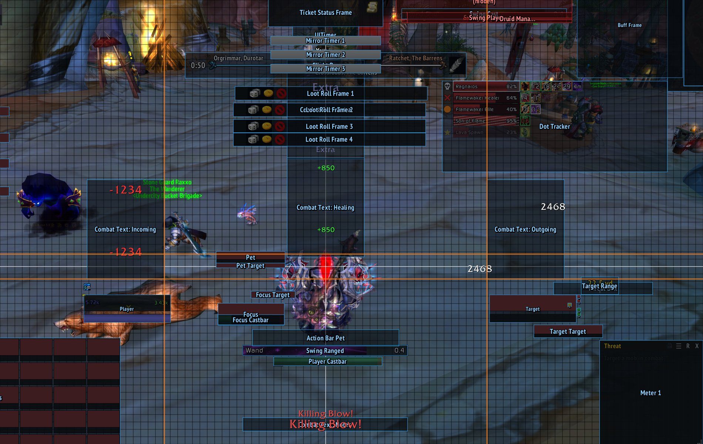

**🧭 Layout mode (`/moveui`):** every frame gets a labelled box. Drag and snap, resize with the wheel, lock frames together, **right-click a box for its options**.

| | |
|---|---|
| 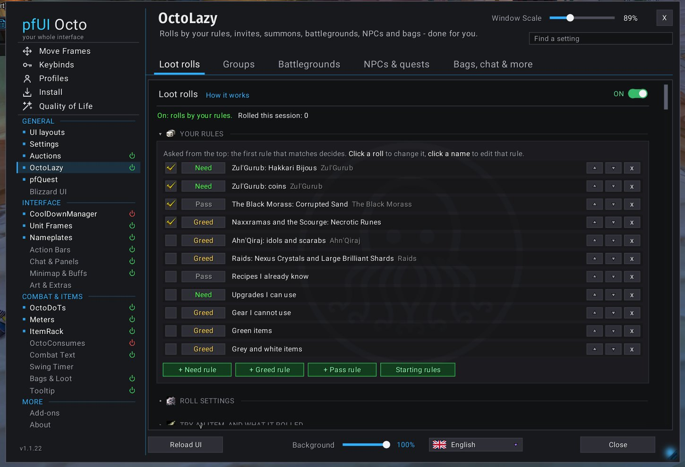 🎲 **OctoLazy**: one rule per item and dungeon - Zul'Gurub bijous, Black Morass sand, Necrotic Runes. Click a roll to change it |  💰 **Auto Loot**: every corpse around you, the moment the fight ends |
|  ⛏️ **Gathering**: the nearest nodes with arrows, shared with your group | 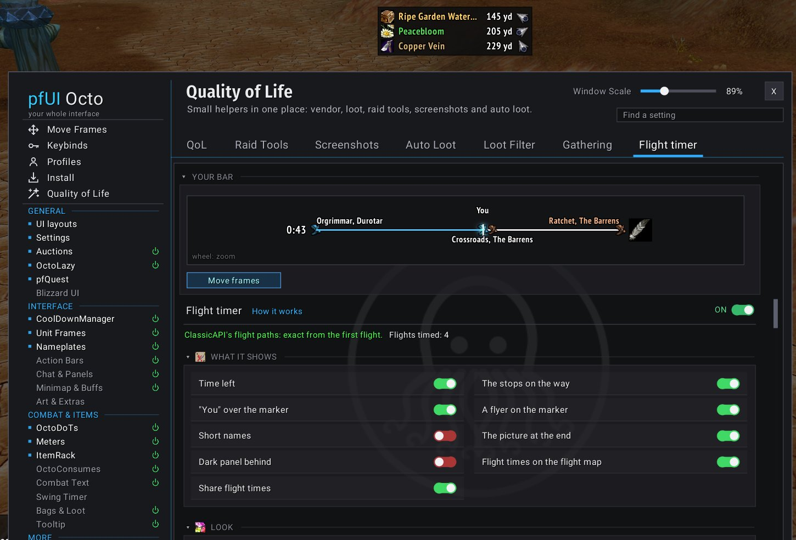 🦅 **Flight timer**: a bar with every stop, how long is left |
| 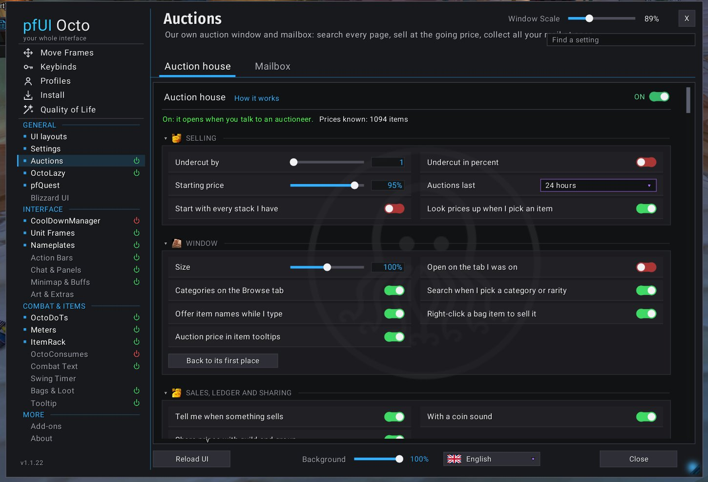 🏦 **Auctions**: our own auction window, every page at once |  📬 **Mail**: the whole inbox in one list, Collect all |
|  🩸 **OctoDoTs**: every enemy and its debuffs, real timers | 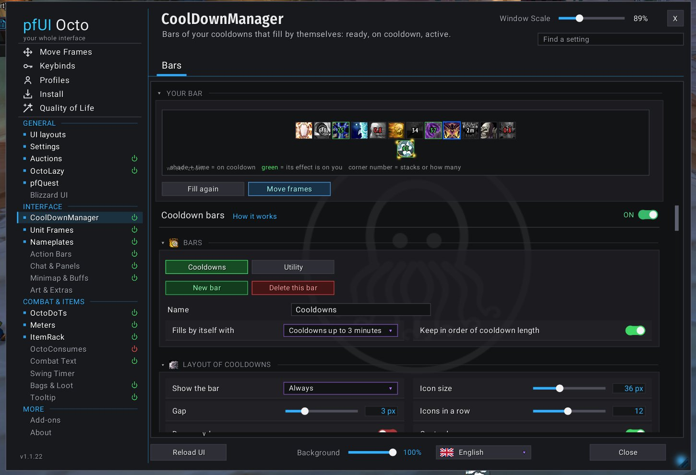 ⏳ **CoolDownManager**: bars that fill themselves |
|  🧪 **OctoConsumes**: never pull without your flask |  🧭 **pfQuest built in**: map pins, tracker, database |
| 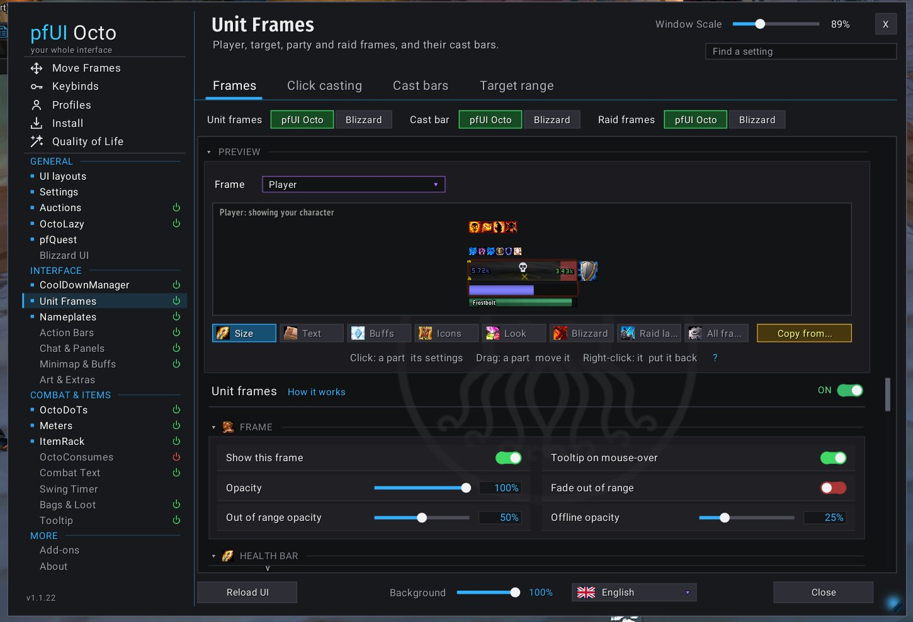 🧍 **Unit frames**: player to raid, live preview | 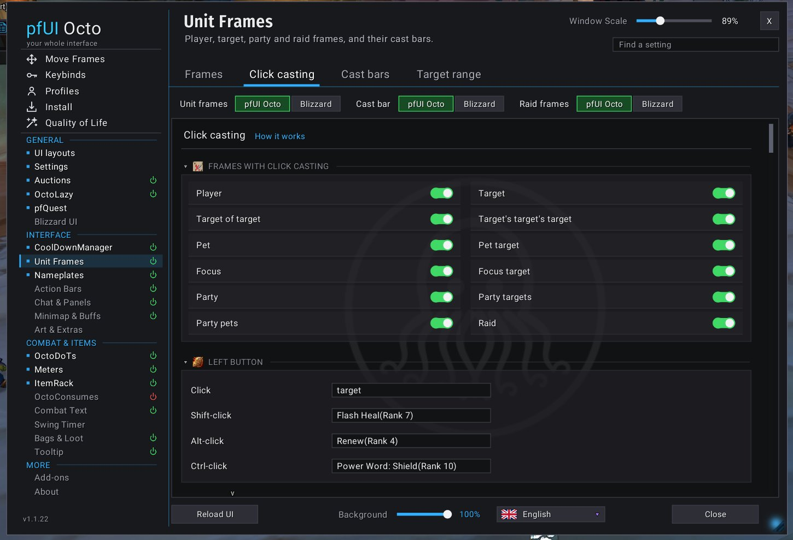 🖱️ **Click casting** on every frame |
| 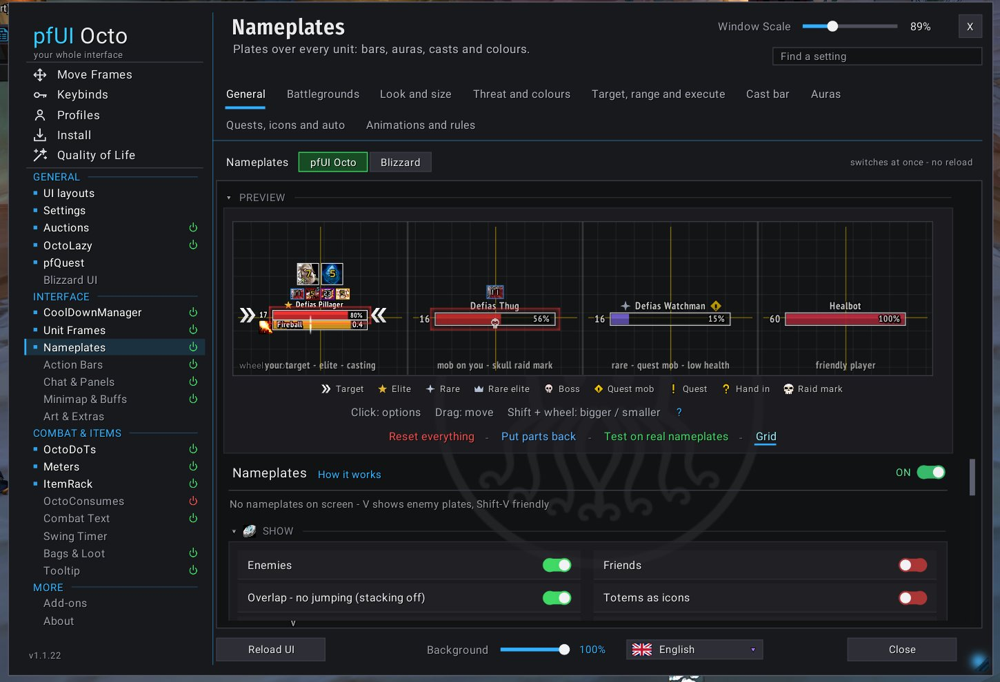 🎯 **Nameplates**: sample plates you click to change | 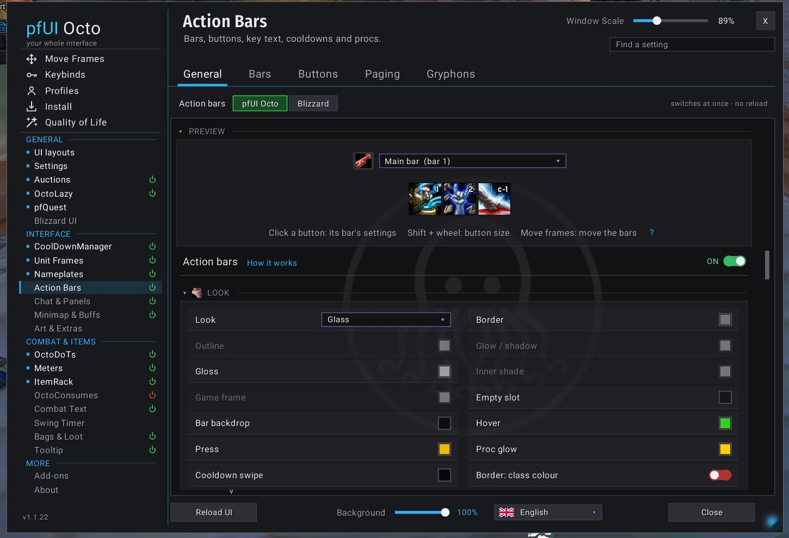 ⚔️ **Action bars**: button looks, proc glows, fading |
| 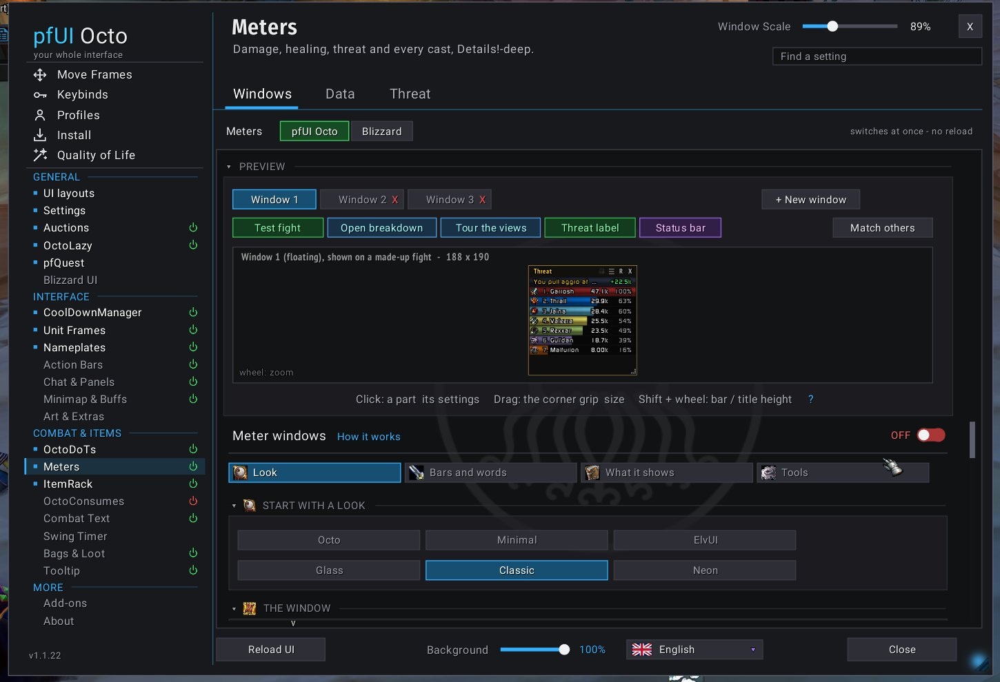 📊 **Meters & threat**: Details!-deep breakdowns |  💥 **Combat text**: place every area yourself |
| 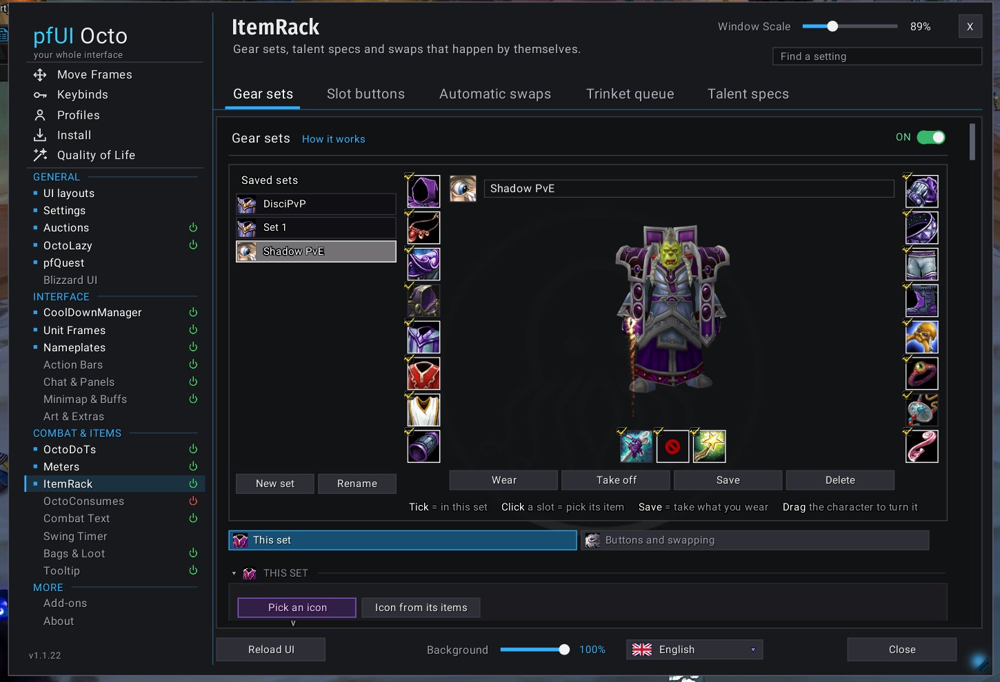 🛡️ **ItemRack**: gear sets, trinkets, specs |  ⏱️ **Swing timer**: every hand, every haste |
|  🎒 **Bags**: categories inside one window | 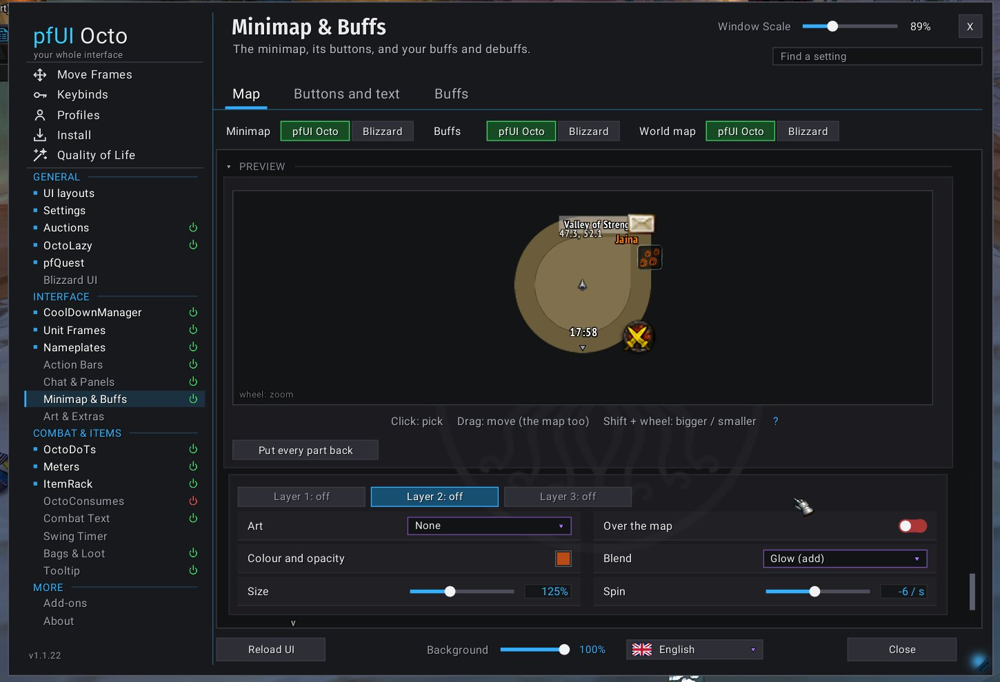 🗺️ **Minimap & buffs**: shapes, buttons, timers |
|  🗺️ **UI layouts**: Normal, Raid, PvP - switch by zone | 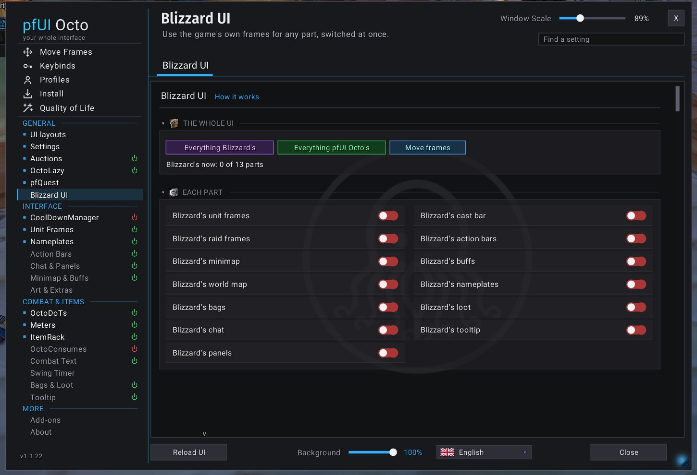 🔁 **Octo or Blizzard**: a switch for every part |
| 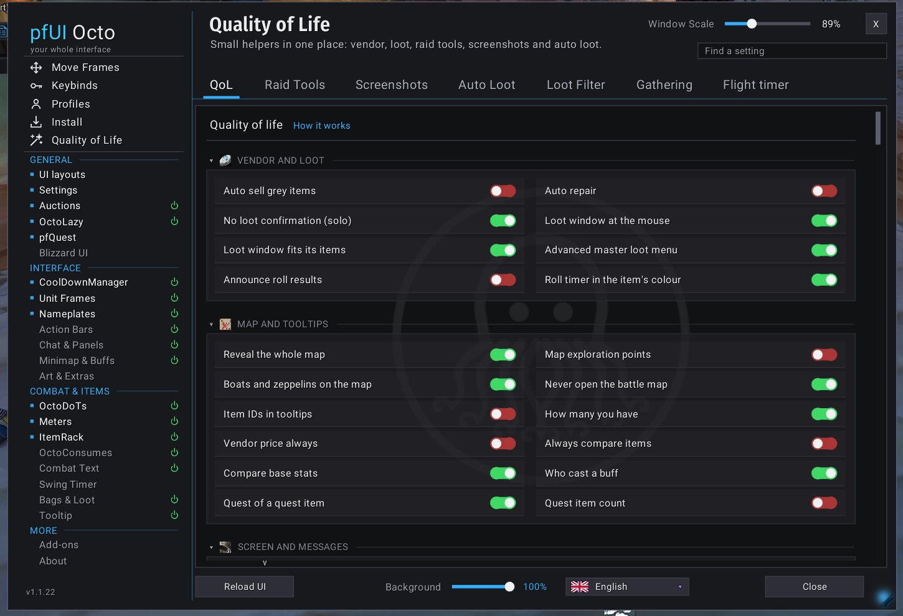 🛠️ **Quality of Life**: raid tools, vendor, screenshots |  📋 **About**: your client mods and the add-ons you can drop |

And more: 🚢 boats, zeppelins and the tram on the world map with arrival times, 🎨 106 elite crests and 7 raid mark sets, ⌨️ a Key Map of your keyboard, 💬 whisper windows, 🌍 the map revealed, 🔔 sale alerts and a gold ledger.

## ⚡ Smooth in every raid

- 🧹 **No hitch mid-pull:** the game's memory clean-up is held until the fight is over (**Settings → Performance**).
- 🎆 **Raid graphics:** inside raids the costliest effects (full-screen glow, weather, particles) go down, and your own settings come back when you leave.
- 📉 **Measure it yourself:** `/pfperf` shows the CPU time of every add-on and the busiest frames (with ClassicAPI).
- 🔇 Everything you switch off isn't loaded at all.

## 🛠️ Install in 4 steps

1. **Close the game.** Add-ons and DLLs are only read when the game starts.
2. **Get pfUI Octo**, one of two ways:
   - 🚀 **OctoLauncher (easiest, updates itself):** **Addons → Add custom git addon** → paste `https://github.com/bdot89/pfUI` → **Check for updates** keeps it current.
     > ❗ Remove an old pfUI first (OctoLauncher's Addons list, or delete `Interface\AddOns\pfUI`; your settings live in `WTF` and stay). OctoLauncher's own list has a *different* pfUI under the same name: don't press **Update** on a ZIP install.
   - ⬇️ **ZIP:** [download pfUI.zip](https://github.com/bdot89/pfUI-Octo/releases/latest/download/pfUI.zip), **Extract All**, put the **pfUI** folder in `OctoWoW\Interface\AddOns` (replace the old one: your settings stay).
3. **Run the DLL installer** *(optional)*: in the pfUI folder double-click **`Install pfUI Octo DLLs.bat`**. "Windows protected your PC": **More info → Run anyway**. It fetches the newest ClassicAPI, SuperWoW, nampower and UnitXP_SP3 from their authors, backs up the old ones and updates `dlls.txt`.
4. **Play!** 🎮 Start the game from **OctoLauncher**. A short wizard picks your look; `/pfui` opens the options, `/moveui` moves frames.

## 🔌 The DLLs: what they add

All optional: pfUI Octo works without them.

| DLL | What it adds |
|---|---|
| 🧬 **ClassicAPI** | Instant gear swaps and sorting, real focus, "can't interrupt" cast bars, DoT timers, Auto Loot, the profiler, item counts |
| 🦸 **SuperWoW** | Focus by GUID, `/pfcast` mouseover casting, enemy cast bars, real casts for meters and the swing timer |
| 🚀 **nampower** | Your queued spell on the cast bar, casts for combat text and meters |
| 📏 **UnitXP_SP3** | Exact distances and line of sight for range fading |
| 🏦 **AuctionQueryThrottle** *(optional extra)* | Auction searches without the game's 5-second wait |

## ⌨️ Commands

| | |
|---|---|
| `/pfui` | the options window |
| `/moveui` | layout mode: move, size, snap, hide |
| `/lazy` | OctoLazy (roll rules, invites, battlegrounds) |
| `/dot` | OctoDoTs (`/dot cast <spell>` for multi-DoT macros) |
| `/autoloot`, `/gather`, `/flight`, `/transports` | Auto Loot, gathering, flight timer, boats & zeppelins |
| `/cdm`, `/consumes`, `/gear` | cooldown bars, consumables, gear sets |
| `/layout [name]` | next UI layout, or the one you name |
| `/keymap`, `/sct` | the Key Map, combat text |
| `/pfperf` | performance numbers (`on`, `off`, `reset`, `clean`) |
| `/export`, `/import` | share your whole setup |

## 📜 New in 1.1.28

- 🏦 **Auctions:** a **Total** column on Browse and Deals - what the whole stack costs to buy out, sortable.

## 📜 New in 1.1.27

- 📬 **Mail:** sending items no longer gets stuck. The Send tab looks like the game's (parchment letter, gold / silver / copper, Send money or C.O.D.), and the To box suggests your alts and the people you mail first, then group, friends, guild and people you've seen.
- 💥 **Combat Text:** one clear choice at the top - On nameplates, Mix or Scrolling on screen - with a list of what shows where; Nameplates and every scroll area say if they're in use.

## 📜 New in 1.1.26

- 💥 **Combat Text:** 8 new movements (Float, Rocket, Drop and bounce, Boomerang, Orbit, Pendulum, Scatter, Helix), 6 new crit effects (Elastic, Punch, Heartbeat, Jiggle, Throb, Stamp), a Feel setting (Steady, Smooth, Snappy, Lazy) and 5 new looks. Crits are now set on each area's tab and on Nameplates; the crit look for every crit is on General. Smoother on screen.
- 👥 **About:** how many players running pfUI Octo are online and heard this week (guild, group and battleground); hover for who and which version.

## 📜 New in 1.1.25

- 🐛 **OctoLazy:** NPCs who train and sell (Survival, Cooking...) no longer jump straight to the shop; their menu stays so you can train.

## 📜 New in 1.1.24

- 🐛 **OctoDoTs:** the "dots.lua:513: attempt to index local `a'" error with several mobs around is fixed.
- 🏦 **Auctions:** own sub-categories under Consumable and Trade Goods (food, potions, flasks, herbs, ore...).
- ⚡ **Performance:** raid graphics can be set to Nowhere (off).

## 📜 New in 1.1.23

- 🎲 **OctoLazy**: _LazyPig rebuilt with roll rules per item and dungeon, invites, summons, battlegrounds, NPC chat and bags.
- 📬 **Mail**: our own mailbox window with a Collect all that never stalls.
- 🩸 **OctoDoTs** (was DoT Tracker): a macro maker with drop-downs; right-click it in layout mode for its options.
- 🎨 **106 new elite crests** and two raid mark sets (icons from game-icons.net).
- ⚡ **Performance** page: no memory hitch in fights, raid graphics, `/pfperf`.
- 🧭 Tidier sidebar, **About** page with clear links and the add-ons you can drop; Blizzard chat's General tab fixed.

[All releases with download links](https://github.com/bdot89/pfUI-Octo/releases)

---

Made with 💙 for the OctoWoW community by **Bdot89** (aka Upsi) · Discord: **benito9295**
Built on [pfUI](https://github.com/shagu/pfUI) by Shagu (MIT). Built in: pfQuest by Shagu, [pfUI-CustomMedia](https://github.com/mr-rosh/pfUI-CustomMedia) by Mr_Rosh (MIT), Cursive-Raid's spell lists (MIT, Kirchlive / Teto). Crest and mark icons from [game-icons.net](https://game-icons.net) (CC BY 3.0) by Lorc, Delapouite, Skoll, sbed, Faithtoken, DarkZaitzev, Caro Asercion and Carl Olsen. Made for the OctoWoW 1.12.1 client. Not affiliated with Blizzard Entertainment.
