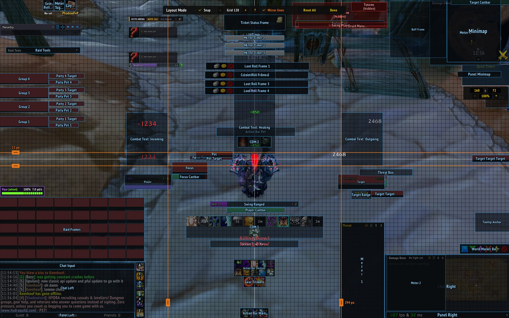
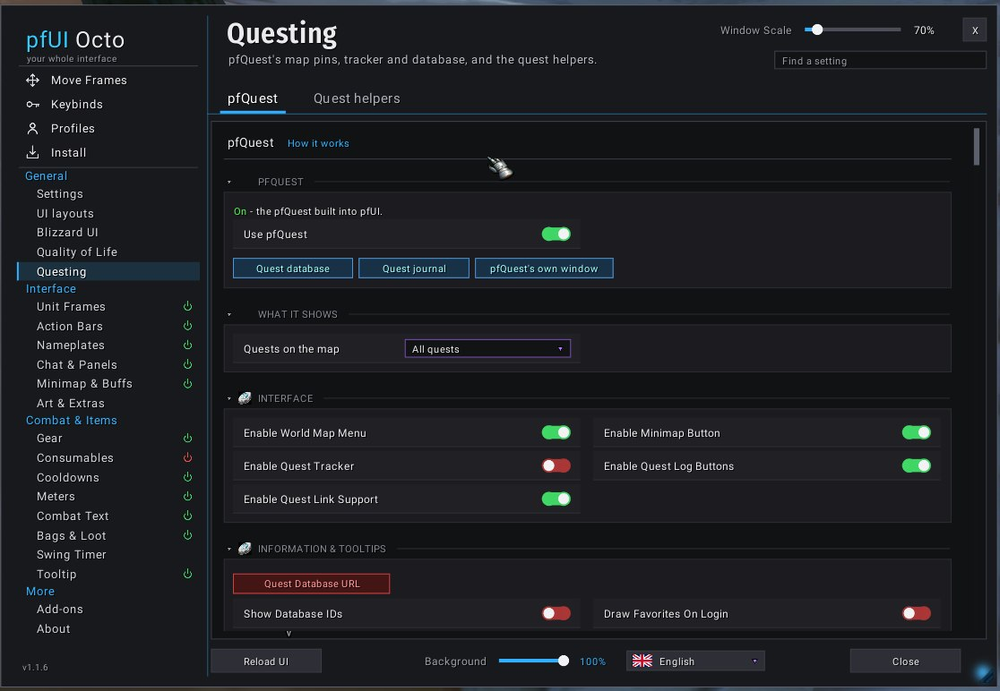
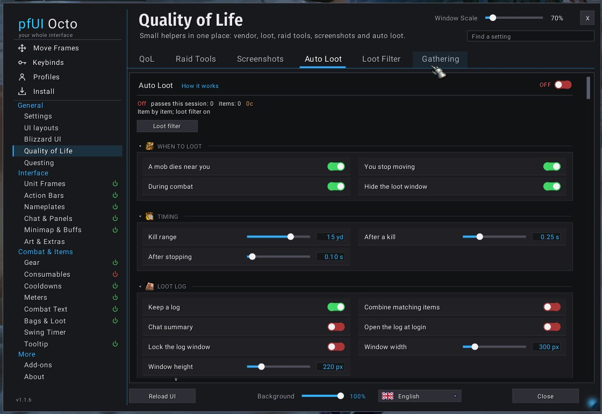
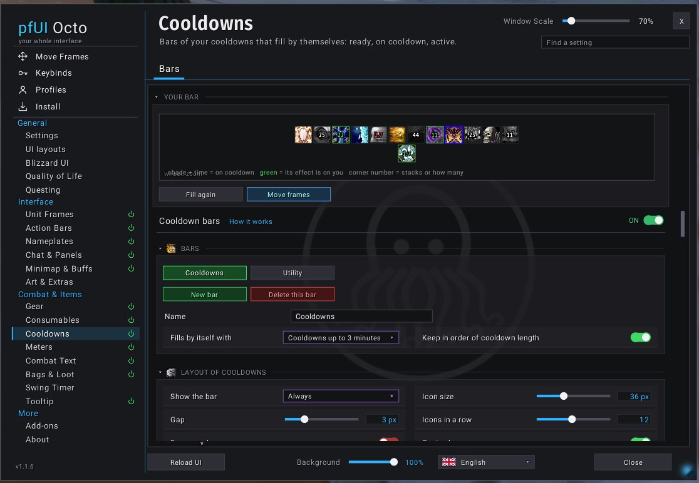
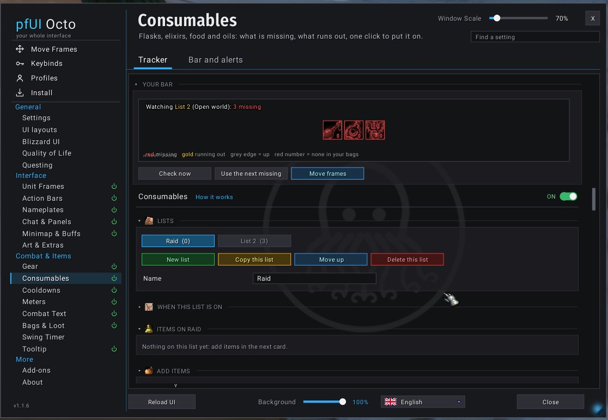
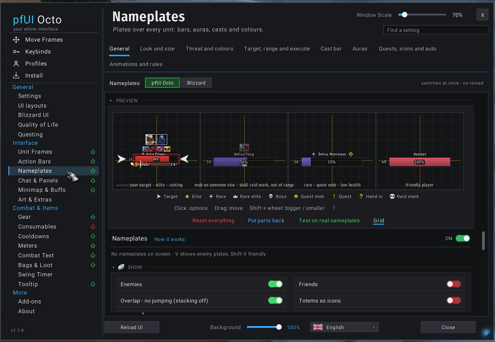
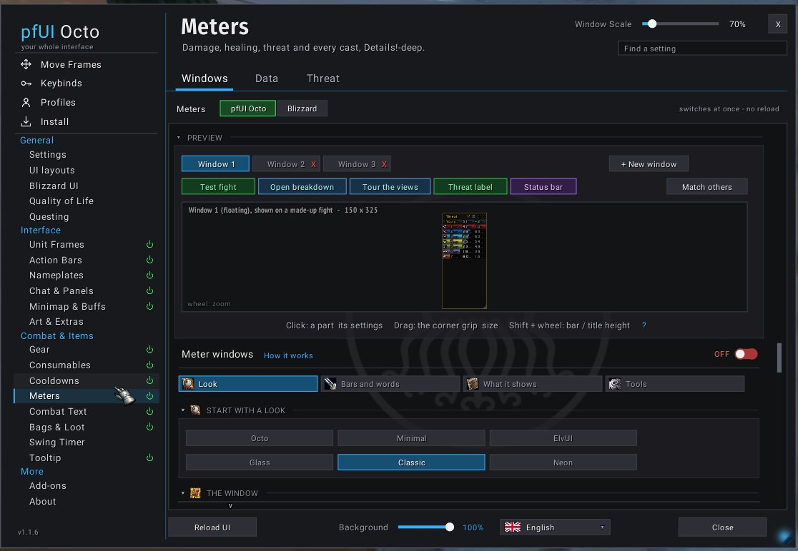
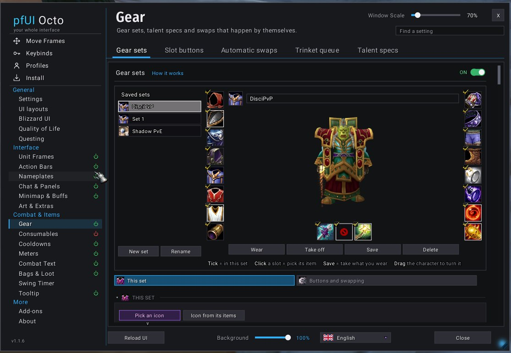
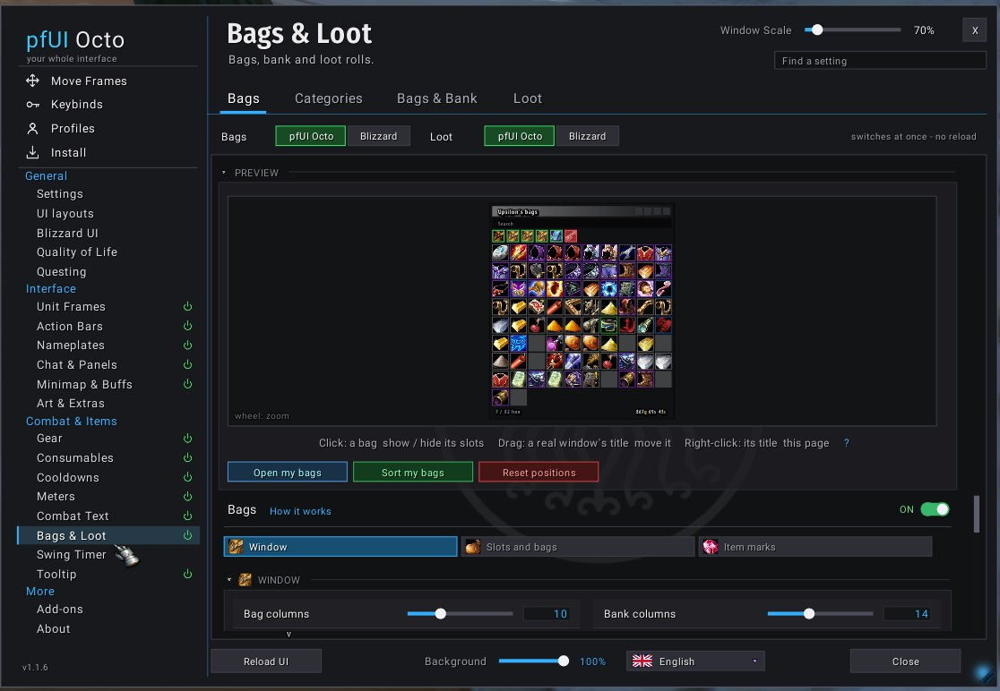
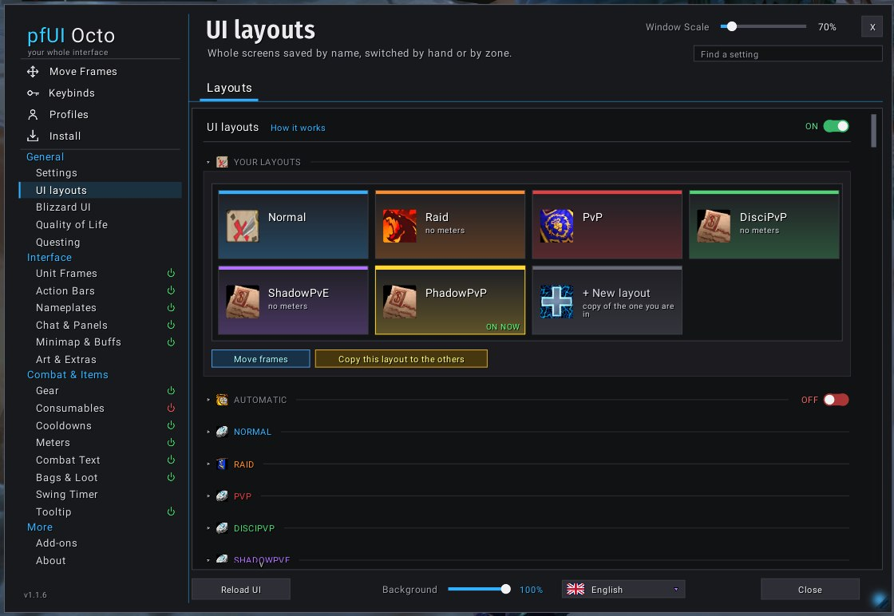

# 🐙 pfUI Octo for OctoWoW

**Your whole interface. One addon.** ✨

> [!CAUTION]
> ## 📁 THE FOLDER MUST BE CALLED `pfUI` - NOTHING ELSE!
> If your folder is called **`pfUI-Octo`**, **`pfUI-octo`**, **`pfUI-Octo-octo`** or **`pfUI-master`**, **DELETE the `-Octo` / `-octo` / `-master` part on the end** so it reads exactly **`pfUI`**.
> ✅ `Interface\AddOns\pfUI` &nbsp;&nbsp; ❌ `Interface\AddOns\pfUI-Octo-octo`
> With the wrong name the game won't load it (OctoLauncher says "Missing .toc file").

> ## 🔌 One-click DLL installer: always the newest versions!
> **It's in the ZIP.** After unzipping, double-click **`Install pfUI Octo DLLs.bat`** in the pfUI folder (game closed). Every time you run it, it fetches the **latest releases** of **ClassicAPI, SuperWoW, nampower and UnitXP_SP3** straight from their authors' GitHub, installs what's missing and updates what's out of date. 🚀
> Run it again any time to stay current. It backs up the old DLLs, adds them to `dlls.txt` for you, and never swaps a newer build you already have for an older one.

**pfUI Octo** is a free all-in-one interface for WoW 1.12 (OctoWoW), **version 1.1.6**, made by **Bdot89**. It replaces a whole folder of addons: unit frames, action bars, nameplates, **a built-in quest helper**, **auto loot**, **cooldown bars**, **a consumables tracker**, meters, threat, combat text, a swing timer, gear sets, a key map and whole UI layouts. Everything is set up from **one options window** with a live preview on every page. 🎛️

### 🔥 New in 1.1
- 🧭 **Quest helper built in:** pfQuest's map pins, quest tracker and `/db` database with OctoWoW's own quests. No Questie or pfQuest to install.
- 💰 **Auto Loot + loot filter:** take what you want, leave the junk, with rules you click together.
- ⏳ **Cooldown bars:** your cooldowns fill the bars by themselves, with 12 glow kinds and animations when they come ready.
- 🧪 **Consumables tracker:** a list per character and raid. It warns you when a flask or buff is missing or running out, and one key puts the next one on.
- 🎒 **Bag categories:** Bagshui-style groups (gear, potions, herbs, junk...) inside one bag window.
- 🛠️ **Quality of Life section + Raid Tools:** ready check, pull timer and raid markers in one bar.
- ⛏️ **Gathering finder:** the nearest herbs, ore, fish and chests with an arrow.
- ⚡ **Smoother raids:** meter windows and nameplates redraw far less often.

> 🧩 **Built on [pfUI](https://github.com/shagu/pfUI) by Shagu:** pfQuest, Clickcast, your profiles and your settings all keep working.

**[⬇️ Download pfUI Octo (ZIP)](https://github.com/bdot89/pfUI-Octo/releases/latest/download/pfUI.zip)** · **[🌐 Web page with screenshots](https://bdot89.github.io/pfUI-Octo/)** · **[📜 What's new](https://github.com/bdot89/pfUI-Octo/releases)** · 💬 Discord: **benito9295**

## 🛠️ Install in 4 steps

1. **Close the game.** Addons and DLLs are only read when the game starts.
2. **Unzip into AddOns.** [Download pfUI.zip](https://github.com/bdot89/pfUI-Octo/releases/latest/download/pfUI.zip), right-click it, **Extract All**, and put the **pfUI** folder in `OctoWoW\Interface\AddOns`. Replace an old pfUI folder: your settings stay.
   > 🚀 **Or let OctoLauncher do it (and keep it updated):** in OctoLauncher open **Addons**, click **Add custom git addon** and paste `https://github.com/bdot89/pfUI` (that copy is named pfUI so the folder comes out right). **Check for updates** then updates it with one click.
   >
   > ❗ **Remove your old pfUI first** (in OctoLauncher's **Addons** list, or delete the `Interface\AddOns\pfUI` folder; your settings live in `WTF` and stay). OctoLauncher's own list has a different pfUI under the same name. It "updates" any pfUI folder that isn't a git copy of ours (an old pfUI, or pfUI Octo from the ZIP) to that one. So don't press **Update** on a ZIP install: remove it and add the link above instead.

   > ⚠️ The folder must be called exactly **pfUI**. Used GitHub's green **Code → Download ZIP** instead? That folder is called **pfUI-Octo-octo**: rename it to **pfUI** (else OctoLauncher says "Missing .toc file" and the game won't load it).
3. **Run the DLL installer** *(optional)*. In that pfUI folder, double-click **Install pfUI Octo DLLs.bat**. "Windows protected your PC": **More info**, then **Run anyway**.
4. **Play!** 🎮 Start the game from **OctoLauncher**. A short setup wizard picks your look and layout. `/pfui` opens the options, `/moveui` moves frames.

## 🌟 What you get

| | |
|---|---|
| 🧭 **Questing** | pfQuest built in: quest givers and objectives on the map, tracker, `/db` item and NPC search |
| 💰 **Auto Loot** | Loot filter rules: always take quest items, leave greys, keep only what you pick |
| ⏳ **Cooldown bars** | Fill themselves from your spell book, live times, glows and animations, item procs |
| 🧪 **Consumables** | Lists per character, raid or spec; warns when missing or running low; one-key reapply |
| 🛠️ **Quality of Life** | Raid Tools bar, auto sell greys, auto repair, screenshots, gathering finder, all on one page |
| 🗺️ **UI layouts** | Normal, Raid, PvP or your own, each with its own frames, meters, gear and spells; switches by itself by zone |
| 🧍 **Unit frames** | Player to raid, with fading health, combat flash, class icons, elite marks, dispel colours, buff timers |
| ⚔️ **Action bars** | 14 button looks, proc glows, cooldown swipes, hover and press effects, fading, end-cap art |
| 🎯 **Nameplates** | Plater-style: 8 looks, auras, cast bars, threat colours, quest marks, range fading, your own rules |
| 📊 **Meters & threat** | Up to 6 windows, full breakdowns of every spell, target and death; a pull warning on your target |
| 💥 **Combat text** | Five areas you place yourself, with looks, crits, sounds and alerts |
| ⏱️ **Swing timer** | Main hand, off hand and ranged, parry haste, queued attacks, Slam and Seal-twist marks |
| 🛡️ **Gear** | Instant set swaps, a trinket queue, slot buttons, automatic swaps, talent specs at the Brainwashing Device |
| ⌨️ **Key Map** | Your keyboard on screen: drag any spell, item or macro onto a key, pick the rank, see every layer |
| 🎒 **Bags, chat, minimap** | Bag categories, instant sorting, new-item glows, chat with class colours, a SexyMap-style minimap, loot roll history |
| 🧭 **Layout mode** | Drag and snap frames, mirrored guide lines, match sizes, lock frames together, hide what you don't need |
| 🔁 **Octo or Blizzard** | A switch on every page: back to Blizzard's frames for that part at once, no reload |

## 📸 Screenshots

**🧭 Layout mode (`/moveui`):** every frame gets a labelled box. Drag and snap them, resize with the wheel, lock frames together, right-click a box for its options.

| | |
|---|---|
|  🧭 **Quest helper built in**: pfQuest's map, tracker and database, no extra addon |  💰 **Auto Loot + loot filter**: rules for what you take and what you leave |
|  ⏳ **Cooldown bars**: fill themselves, glow when ready |  🧪 **Consumables**: never pull without your flask again |
|  🎯 **Nameplates**: Plater-style, live sample plates |  📊 **Meters**: Details!-style windows and breakdowns |
|  🛡️ **Gear sets**: instant swaps, trinket queue, specs |  🎒 **Bags**: one window, categories, one-click sorting |
|  🗺️ **UI layouts**: Normal, Raid, PvP, switching by zone |  ⌨️ **Key Map**: drag spells onto your keyboard |

## 📜 Release notes

- **1.1.6** 🎯 Nameplate target glow: size, pulse and a bright glow that stands out in smoke.
- **1.1.5** 💤 AFK / DND marks on unit frames, instant weapon-oil tracking, cooldown bar glows and animations.
- **1.1.4** ⚡ Smoother raids: meters redraw 3 times a second instead of every frame, less nameplate garbage.
- **1.1.3** 🧊 Fixed freezes with macros (Pick Pocket and SuperCleveRoidMacros).
- **1.1.2** ➕ Incoming heals as a number on unit frames.
- **1.1.1** 🤝 Gathering nodes shared with your group.
- **1.1.0** 🔥 pfQuest built in, gathering finder, consumables tracker, bag categories, loot filter and Auto Loot, Quality of Life + Raid Tools, CustomMedia, translations, your own proc glows, instant threat, many crash fixes.
- **1.0.0** 🐙 First release (26 Oct 2026).

[All releases with download links](https://github.com/bdot89/pfUI-Octo/releases)

## ⚡ The DLLs: what they add

All optional: pfUI Octo works without them, and nobody loses a feature. The installer gets all four, or tick **nampower** and **unitXp** in OctoLauncher's mod list.

| DLL | What it adds |
|---|---|
| 🧬 **ClassicAPI** | Instant gear swaps and bag sorting, a real focus, "can't interrupt" cast bars, the combat log for meters, map reveal for OctoWoW's zones, item counts, loot history |
| 🦸 **SuperWoW** | Focus by GUID, `/pfcast` mouseover casting, enemy cast bars, real casts for the swing timer and meters |
| 🚀 **nampower** | Your queued spell on the cast bar, spell casts for combat text and meters |
| 📏 **UnitXP_SP3** | Exact distances and line of sight for range fading on plates and frames |

## ⌨️ Commands

| | |
|---|---|
| `/pfui` | the options window |
| `/moveui` | layout mode: move, size, snap, hide |
| `/layout [name]` | next UI layout, or the one you name |
| `/gear` | gear sets (`naked`, `queue`, `specs`) |
| `/keymap` | the Key Map |
| `/sct` | combat text pages |
| `/loothistory` | who rolled what (ClassicAPI) |
| `/export`, `/import` | share your whole setup |

---

Made with 💙 for the OctoWoW community by **Bdot89** · Discord: **benito9295**
Based on [pfUI](https://github.com/shagu/pfUI) by Shagu (MIT licence). Made for the OctoWoW 1.12.1 client. Not affiliated with Blizzard Entertainment.
